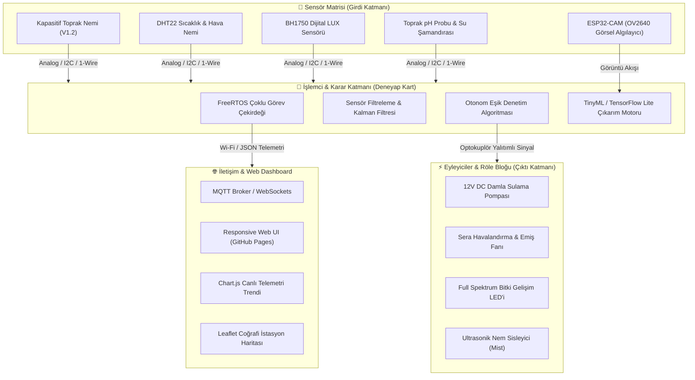

<div align="center">

# 🌱 Plantelligence
### Yapay Zeka Destekli Akıllı Sera ve Otonom Bitki Bakım Sistemi
**AI-Powered Smart IoT Greenhouse & Autonomous Plant Telemetry Platform**

<br/>

[](https://nothingmantr.github.io/Plantelligence/)
[](https://github.com/NothingManTR/Plantelligence)
[](LICENSE)
[](https://deneyapkart.org/)
[](https://www.tensorflow.org/lite)

<p align="center">
  <a href="#-proje-hakkında">Proje Hakkında</a> •
  <a href="#-temel-özellikler">Özellikler</a> •
  <a href="#-canlı-simülatör--web-dashboard">Canlı Simülatör</a> •
  <a href="#-sistem-mimarisi">Sistem Mimarisi</a> •
  <a href="#-donanım-bileşenleri-bom">Donanım Listesi</a> •
  <a href="#-yazılım-altyapısı">Yazılım</a> •
  <a href="#-ekibimiz">Ekip</a> •
  <a href="#-lisans">Lisans</a>
</p>

---

</div>

## 📖 Proje Hakkında

**Plantelligence**, geleneksel tarım ve hobi seracılığında yaşanan yüksek su israfı, aşırı/yetersiz sulamadan kaynaklanan kök çürümesi ve hastalıkların geç fark edilmesi gibi kronik sorunları çözmek amacıyla geliştirilmiş **uçtan uca otonom bir kapalı devre sera yönetim platformudur**.

Sistem; Türkiye'nin yerli mikrokontrolörü **Deneyap Kart** ve **ESP32-CAM** donanımları üzerine inşa edilmiştir. Toprak nemi, ortam sıcaklığı, hava nemi, ışık şiddeti (LUX) ve toprak pH değerini anlık olarak izler. Elde edilen telemetri verileri yerleşik kural motoru ve makine öğrenimi modelleri tarafından işlenerek damla sulama pompası, sirkülasyon fanı, full spektrum bitki büyüme LED'leri ve ultrasonik sisleme ünitelerini otonom olarak yönetir.

> [!TIP]
> **Canlı Etkileşim:** Sistemin web telemetri panelini ve canlı sera simülatörünü tarayıcınızda anında denemek için [**nothingmantr.github.io/Plantelligence**](https://nothingmantr.github.io/Plantelligence/) adresini ziyaret edin.

---

## ⚡ Temel Özellikler

| Özellik | Açıklama | Fayda / Metrik |
| :--- | :--- | :---: |
| 💧 **Dinamik Nabız Sulama** | Sabit zaman sayaçları yerine toprağın gerçek osmotik su potansiyeline göre sulama yapar. | **%70 Su Tasarrufu** |
| 🧠 **Otonom Kapalı Devre Kontrol** | Sensör verilerini Deneyap Kart üzerinde filtreleyip eyleyicileri mikrosaniyeler içinde tetikler. | **%98 Bitki Yaşam Oranı** |
| 🔬 **AI Bitki Hastalık Teşhisi** | ESP32-CAM ve TinyML modelleri ile yaprak lekelerini ve kloroz belirtilerini erken evrede tespit eder. | **%96.8 Doğruluk Skoru** |
| 📊 **Gerçek Zamanlı Web Telemetrisi** | Chart.js destekli canlı zaman serisi grafikleri ve Leaflet coğrafi istasyon haritası. | **<50ms Veri Yenileme** |
| 🛡️ **Galvanik İzolasyon & Güvenlik** | Optokuplör korumalı röle bloğu ve ters akım korumasıyla donanımsal güvenlik. | **Yüksek Güvenilirlik** |
| 📶 **Çevrimdışı (Offline) Dayanıklılık** | İnternet kopsa dahi yerel EEPROM kuralları sayesinde kesintisiz otonom çalışma. | **7/24 Kesintisiz Hizmet** |

---

## 🖥️ Canlı Simülatör & Web Dashboard

Plantelligence web platformu, doğrudan istemci tarafında çalışan yüksek performanslı bir dijital ikiz (digital twin) simülasyonuna sahiptir:

- **Çift Çalışma Modu:** Tek tıkla `Otonom AI Modu` ile `Manuel Kontrol Modu` arasında geçiş.
- **İnteraktif Eyleyici Anahtarları:** Damla sulama pompası, havalandırma fanı, büyüme ışığı ve sisleyiciyi doğrudan tarayıcıdan kontrol etme imkanı.
- **Canlı Telemetri Akışı:** Toprak nemi ve sıcaklığın dinamik dalgalanmasını gösteren reaktif `Chart.js` grafiği.
- **Akıllı Hastalık Taraması:** Domates, Çilek, Fesleğen ve Orkide gibi farklı bitki profillerine özel agronomik eşik değerlendirmesi.

---

## 🏗️ Sistem Mimarisi



---

## 🔌 Donanım Bileşenleri (BOM)

| Bileşen | Model / Spesifikasyon | İletişim Protokolü | Fonksiyon |
| :--- | :--- | :---: | :--- |
| **Ana İşlemci Kartı** | **Deneyap Kart (Dual-Core LX6 240MHz)** | Wi-Fi / BLE / GPIO | Merkezi kontrol ve karar birimi |
| **Görüntü İşleme Kartı** | **ESP32-CAM + OV2640 Kamera Modülü** | SPI / UART | Yaprak sağlığı ve hastalık taraması |
| **Toprak Nemi Sensörü** | **Kapasitif Nem Sensörü v1.2** | Analog (ADC) | Korozyonsuz toprak osmotik nem ölçümü |
| **Hava Durumu Sensörü** | **DHT22 (AM2302)** | Single-Bus Dijital | Sera içi bağıl nem ve sıcaklık takibi |
| **Işık Şiddeti Sensörü** | **BH1750FVI** | I2C (0x23) | 1-65535 LUX aydınlatma şiddeti ölçümü |
| **Eyleyici Sürücü** | **4 Kanallı Optokuplör Korumalı Röle** | Dijital GPIO (Aktif Düşük) | Yüksek akımlı 12V/220V yük izolasyonu |
| **Sulama Pompası** | **12V DC Diyaframlı Mikro Pompa** | Röle Kanal 1 | Hassas damla sulama boru hattı |
| **Sirkülasyon Fanı** | **12V Fırçasız DC Fan (Brushless)** | Röle Kanal 2 | Aşırı ısı ve nem tahliyesi |
| **Bitki Yetiştirme LED'i** | **Samsung LM301B Full Spektrum LED** | Röle Kanal 3 | Fotosentez destekli yapay aydınlatma |

---

## 💻 Yazılım Altyapısı

- **Gömülü Yazılım:** C++ (Arduino IDE / Deneyap SDK), FreeRTOS görev yönetimi, düşük güç derin uyku optimizasyonları.
- **Yapay Zeka & Görüntü Analizi:** Python 3.10+, TensorFlow Lite Quantized (int8) MobileNetV2-Lite mimarisi, OpenCV.
- **Web & Dashboard:** HTML5, Modern CSS3 (CSS Variables, Glassmorphism, Bento Grid, Responsive Flex/Grid), Vanilla JavaScript (ES6+).
- **Görselleştirme Kütüphaneleri:** [Chart.js](https://www.chartjs.org/) (Zaman serisi telemetri akışı), [Leaflet.js](https://leafletjs.com/) (İstasyon konum haritası).
- **Barındırma & Dağıtım:** GitHub Pages (Serverless statik web hosting), GitHub Actions CI/CD otomatik dağıtım.

---

## 🚀 Hızlı Başlangıç

### 1. Repoyu Klonlayın
```bash
git clone https://github.com/NothingManTR/Plantelligence.git
cd Plantelligence
```

### 2. Web Sayfasını Yerel Olarak Çalıştırın
Herhangi bir statik sunucu ile doğrudan çalıştırabilirsiniz:
```bash
# Python 3 ile
python3 -m http.server 8080

# veya Node.js npx ile
npx serve .
```
Ardından tarayıcınızdan `http://localhost:8080` adresine gidin.

### 3. Canlı Yayını İnceleyin
GitHub Pages üzerinden doğrudan test edin:  
👉 [**https://nothingmantr.github.io/Plantelligence/**](https://nothingmantr.github.io/Plantelligence/)

---

## 👥 Ekibimiz

Plantelligence; mekatronik, gömülü sistemler, yapay zeka, botanik ve yazılım disiplinlerinin ortak çalışması ile hayata geçirilmiştir:

- **Emre Yazan** — Takım Lideri & Proje Yöneticisi *(Proje koordinasyonu, stratejik yol haritası ve sistem mimarisi)*
- **Eser Çamlıbel** — Yazılım & IoT Mühendisi *(C++ optimizasyonu, IoT haberleşme protokolleri ve gömülü sistem mimarisi)*
- **Taha Can Tunç** — Gömülü Sistemler & Yapay Zeka Uzmanı *(Deneyap Kart programlama, sensör füzyonu, TinyML modelleri ve Linux)* • [Portfolyo](https://nothingmantr.github.io/Taha-Can-Tunc/) • [GitHub](https://github.com/NothingManTR)
- **Ali Kerem Özfidan** — Botanik & Tarım Teknolojileri Uzmanı *(Bitki fizyolojisi, toprak-besin dinamikleri ve agronomik modelleme)*
- **Taha Ramazan Lim** — Donanım & Elektronik Tasarım *(PCB devre tasarımı, optokuplör izolasyonu ve prototip montajı)*
- **Ahmet Öztürk** — Full Stack Web Geliştirici *(Web dashboard arayüzü, Chart.js telemetrisi ve REST API)*

---

## 📜 Lisans

Bu proje **[MIT Lisansı](LICENSE)** kapsamında açık kaynaklı olarak paylaşılmıştır. Detaylar için `LICENSE` dosyasına göz atabilirsiniz.

<div align="center">
  <sub>Geleceğin Akıllı ve Sürdürülebilir Tarımı İçin 💚 ile Tasarlandı.</sub>
</div>