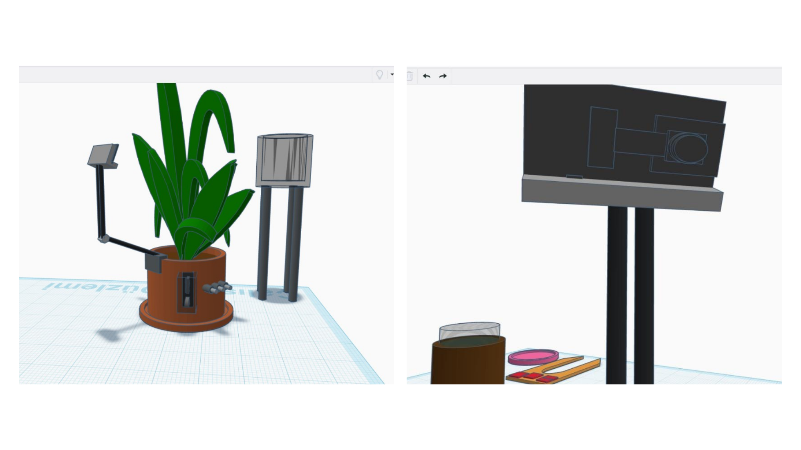
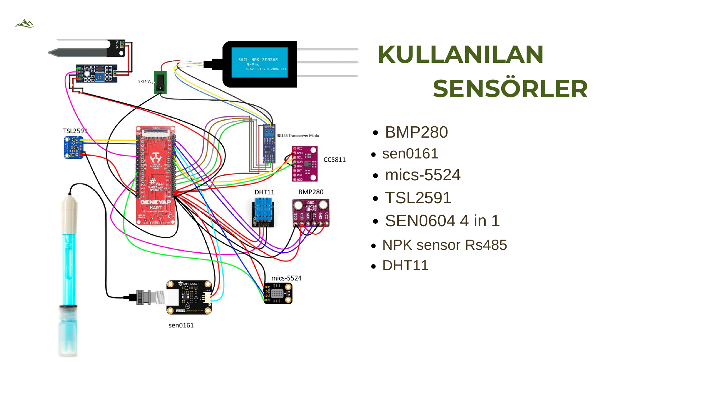
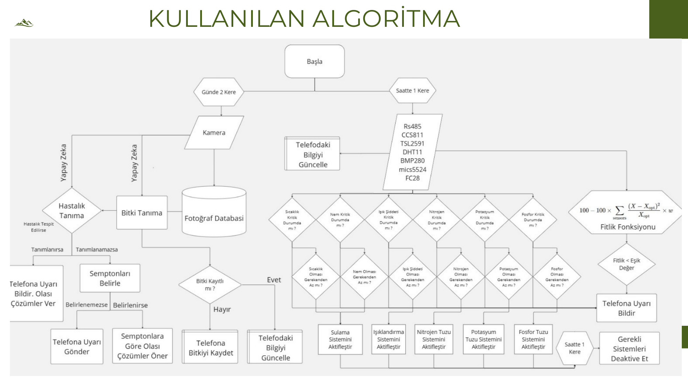
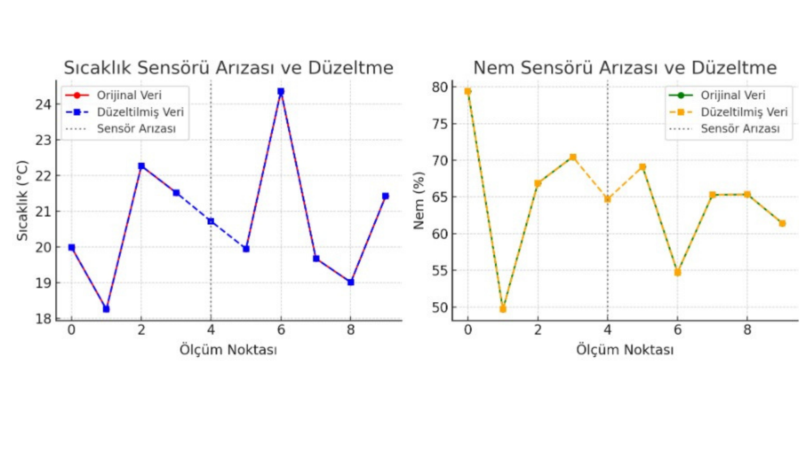
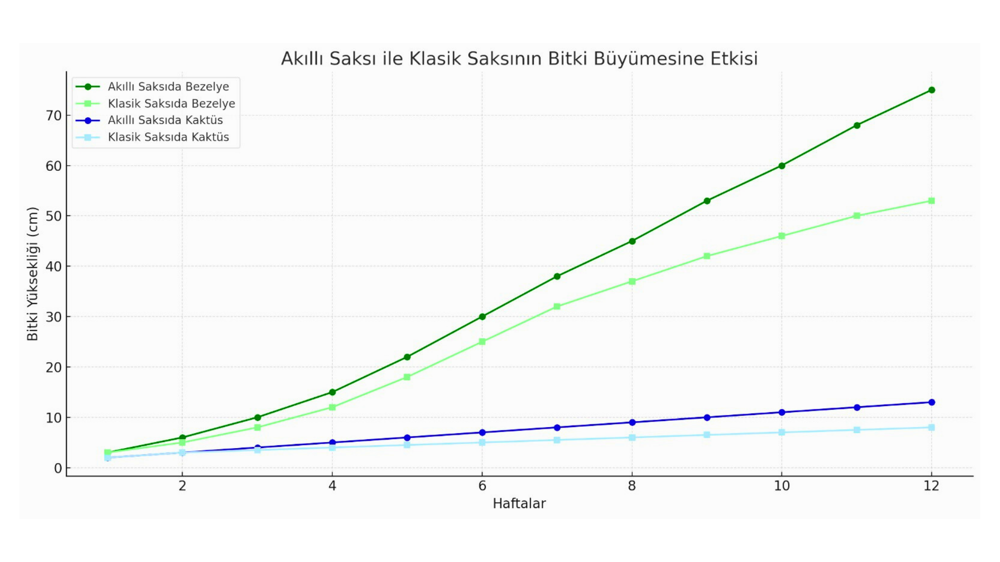
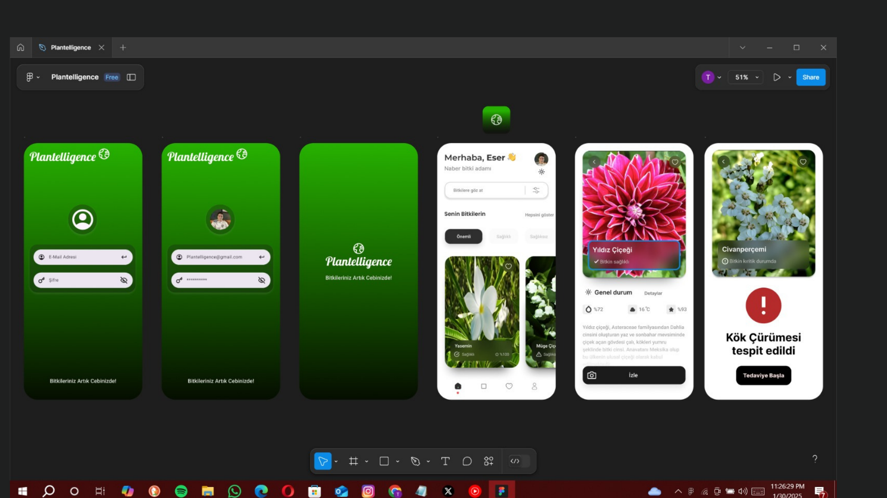

# 🌱 Plantelligence
### TÜBİTAK 2209-A — Yapay Zeka Destekli Otonom Akıllı Saksı ve Bitki Bakım Sistemi
**AI-Powered Smart IoT Planter & Autonomous Plant Healthcare Platform**

 

  <a href="#-proje-hakkında">Proje Hakkında</a> •
  <a href="#-yenilikçi-yön--özellikler">Yenilikçi Yön</a> •
  <a href="#-akıllı-saksı-3d-cad-tasarımı">3D CAD Tasarımı</a> •
  <a href="#-donanım-mimarisi-ve-sensör-matrisi">Sensör Matrisi & BOM</a> •
  <a href="#-özgün-algoritma-ve-karar-motoru">Karar Motoru</a> •
  <a href="#-12-haftalık-deneysel-büyüme-sonuçları">Deney Sonuçları</a> •
  <a href="#-tübitak-2209-a-proje-süreci">Proje Süreci</a> •
  <a href="#-proje-yürütücüsü">Geliştirici</a> •
  <a href="#-lisans">Lisans</a>

---

## 📖 Proje Hakkında

**Plantelligence**, TÜBİTAK 2209-A Üniversite Öğrencileri Araştırma Projeleri Destekleme Programı kapsamında geliştirilmiş; bitki bakımındaki zorlukları ortadan kaldıran, kaynak israfını önleyen ve bitkilerin sağlık durumunu yapay zeka ile 7/24 izleyip otonom tedavi eden **yeni nesil akıllı saksı ve kapalı devre yetiştirme sistemidir**.

Sistem, Türkiye'nin yerli geliştirme kartı **Deneyap Kart**, **ESP32-CAM**, **RS485 endüstriyel NPK sensörü** ve **3 tüplü mikro besin dozajlama ünitesi (Azot, Fosfor, Potasyum)** ile donatılmıştır. Toprağın ve çevrenin tüm agronomik parametrelerini ölçer, özgün **Fitlik Fonksiyonu** formülü ile değerlendirir ve insan müdahalesine ihtiyaç duymadan bitkiyi hayatta tutar.

> [!TIP]
> **Canlı Etkileşim:** Sistemin web telemetri panelini, fitlik skoru hesaplayıcısını ve canlı simülatörünü tarayıcınızda denemek için [**nothingmantr.github.io/Plantelligence**](https://nothingmantr.github.io/Plantelligence/) adresini ziyaret edin.

---

## ⚡ Yenilikçi Yön & Özellikler

- 🔬 **Görsel Hastalık Tanıma & Otonom Tedavi:** Saksıya monte edilmiş ESP32-CAM ile günde 2 kez bitki fotoğrafı alınır; görüntü işleme modelleriyle yaprak lekeleri ve kök çürümesi erken evrede teşhis edilip tedavi süreci başlatılır.
- 📹 **7/24 Canlı İzleme:** Kullanıcı istediği an akıllı saksı kamerasına bağlanarak bitkinin anlık gelişimini ve yaprak durumunu mobil/web arayüzünden izleyebilir.
- 🧪 **3 Tüplü NPK Gübreleme (Azot - Fosfor - Potasyum):** Klasik akıllı saksıların aksine sadece su değil; RS485 NPK sensöründen gelen değerlere göre 3 bağımsız tüpten toprağa mililitrik dozajlama yapılır.
- 📐 **Fitlik Fonksiyonu ile Otonom Dengeleme:** Sistem saatte bir tüm sensörleri okuyarak sapmaları hesaplar; fitlik skoru eşik değerin altına düştüğünde ilgili sulama, gübreleme veya ışıklandırma eyleyicisini devreye sokar.
- 🛡️ **Sensör Arıza Toleransı & Hata Düzeltme:** Sensörlerde meydana gelebilecek gürültü ve veri sıçramaları filtreleme algoritmalarıyla düzeltilerek sistem kararlılığı korunur.

---

## 🪴 Akıllı Saksı 3D CAD Tasarımı

Sistem için özel olarak modellenen akıllı saksı gövdesi; su rezervuarı, 3 tüplü NPK besin kalkanı, sensör giriş yuvaları ve ayarlanabilir ESP32-CAM kamera kolunu bünyesinde barındırır:

  
  
<em>Plantelligence Akıllı Saksı ve Kamera Montajı 3D CAD Modeli (SolidWorks / Tinkercad)</em>

---

## 🔌 Donanım Mimarisi ve Sensör Matrisi

Projede kullanılan tüm sensör ve modüller **Deneyap Kart** üzerinde toplanmış olup korumalı röleler ve MAX485 dönüştürücü ile izole edilmiştir:

  
  
<em>Deneyap Kart, Sensör Matrisi ve Eyleyici Bağlantı Şeması</em>

### 📋 Kullanılan Malzemeler (BOM)

| Bileşen | Model / Donanım | Bağlantı Arayüzü | Fonksiyon |
| :--- | :--- | :---: | :--- |
| **Ana İşlemci** | **Deneyap Kart (Dual-Core LX6 240MHz)** | Wi-Fi / BLE / GPIO | Merkezi denetim ve fitlik algoritması |
| **Kamera & Görsel AI** | **ESP32-CAM + OV2640** | Wi-Fi / SPI | 7/24 canlı akış ve hastalık tespiti |
| **Toprak Besin Sensörü** | **NPK Sensör RS485 (MAX485 Transceiver)** | UART / RS485 | Toprak Azot, Fosfor ve Potasyum ölçümü |
| **Toprak pH Sensörü** | **DFRobot SEN0161 Gravity Analog pH v2.0** | Analog ADC | Toprak asidite/alkalinite dengesi takibi |
| **Işık Şiddeti Sensörü** | **TSL2591 Dijital LUX Sensörü** | I2C (0x29) | 1-65535 LUX yüksek hassasiyetli ışık |
| **Hava Kalitesi Sensörleri**| **CCS811 & MiCS-5524** | I2C / Analog | eCO2, VOC ve uçucu gaz konsantrasyonu |
| **İklim Sensörleri** | **BMP280 & DHT11** | I2C / 1-Wire | Sıcaklık, nem ve barometrik basınç |
| **Toprak Nemi** | **FC-28 / Kapasitif Nem Probu** | Analog ADC | Kök bölgesi nem seviyesi |
| **NPK Besin Dozajlama** | **3 Tüp Tuz (Azot, Fosfor, Potasyum)** | Röle Kanalları | Otonom mineral takviyesi |
| **Sulama & Eyleyiciler** | **12V Su Pompası, Röle Ünitesi, LED** | Dijital GPIO / PWM | Sulama ve aydınlatma eyleyicileri |

---

## 🧠 Özgün Algoritma ve Karar Motoru

Sistem iki paralel çevrim halinde çalışır:

1. **Günde 2 Kez Görsel Çevrim:** ESP32-CAM kamerası ile yaprak fotoğrafları taranır. Veri tabanındaki hastalık profilleriyle karşılaştırılır; semptomlar belirlenirse telefona bildirim gider ve tedavi başlatılır.
2. **Saatte 1 Kez Telemetri Çevrimi:** Tüm sensörler taranarak aşağıdaki **Fitlik Fonksiyonu** ile sistem sağlığı puanlanır:

$$\text{Fitlik} = 100 - 100 \times \sum_{\text{sensors}} \frac{(X_i - X_{opt})^2}{X_{opt}} \times w_i$$

Fitlik değeri belirlenen eşik değerin altına düştüğünde ilgili alt eyleyici (sulama pompası, azot/fosfor/potasyum dozajlama veya LED aydınlatma) otomatik tetiklenir.

  
  
<em>TÜBİTAK 2209-A Otonom Algoritma ve Karar Akış Şeması</em>

### 🛡️ Sensör Arıza Tespiti ve Düzeltme
Sensör hatası veya anlık parazit durumlarında sistem geçmiş veriler üzerinden hata tespit algoritmasını çalıştırarak veriyi düzeltir:

  
  
<em>Sıcaklık ve Nem Sensörü Hata Tespiti ve Kalman Düzeltme Eğrileri</em>

---

## 📊 12 Haftalık Deneysel Büyüme Sonuçları

Klasik saksı ve Plantelligence Akıllı Saksı arasında yürütülen 12 haftalık kontrollü deneyler:

  
  
<em>Akıllı Saksı ile Klasik Saksının Bitki Büyümesine Etkisi (12 Hafta)</em>

- **Bezelye Bitkisi:** Akıllı saksıda **75 cm** boya ulaşırken, klasik saksıda 53 cm'de kalmıştır (**%41.5 büyüme artışı**).
- **Kaktüs:** Akıllı saksıda **13 cm**, klasik saksıda 8 cm büyüme kaydedilmiştir (**%62.5 büyüme artışı**).

---

## 📱 Mobil Uygulama Arayüzü (Figma)

"Bitkileriniz Artık Cebinizde!" konseptiyle geliştirilen mobil uygulama arayüzü; bitki sağlığını, NPK durumunu, canlı kamera görüntüsünü ve tedavi komutlarını kullanıcıya sunar:

  
  
<em>Figma Ortamında Tasarlanan Mobil Kullanıcı Arayüzü</em>

---

## 📅 TÜBİTAK 2209-A Proje Süreci

| Aşama | Tarih Aralığı | İş Paketi & Açıklama |
| :---: | :--- | :--- |
| **01** | 1 Ocak - 7 Ocak 2024 | Proje Planlama, Amaç ve Yöntemlerin Belirlenmesi |
| **02** | 8 Ocak - 21 Ocak 2024 | Gerekli Sensörlerin ve Yazılım Altyapısının Araştırılması |
| **03** | 22 Ocak - 11 Şubat 2024 | 3D CAD Akıllı Saksı Tasarımı ve Sensör Prototipi |
| **04** | 12 Şubat - 25 Şubat 2024 | Gömülü Yazılım, Fitlik Algoritması ve AI Modelleri |
| **05** | 26 Şubat - 17 Mart 2024 | Mobil Uygulama Geliştirme ve Veri Entegrasyonu |
| **06** | 18 Mart - 7 Nisan 2024 | 12 Haftalık Sistem Testleri, Optimizasyon ve Hata Ayıklama |
| **07** | 8 Nisan - 21 Nisan 2024 | Final Prototipinin Tamamlanması ve Gözden Geçirme |
| **08** | 22 Nisan - 28 Nisan 2024 | Proje Raporunun Hazırlanması ve TÜBİTAK Sunumu |

---

## 👨‍💻 Proje Yürütücüsü

<table border="0">
  <tr>
    <td width="130" align="center" valign="top">
      
    </td>
    <td>
      <h3>Taha Can Tunç</h3>
      
<strong>TÜBİTAK 2209-A Proje Yürütücüsü & Geliştirici</strong>

      
Manisa Celal Bayar Üniversitesi Mekatronik Mühendisliği öğrencisi. Gömülü sistemler (C/C++), mikrokontrolörler (Deneyap Kart, ESP32, Arduino), yapay zeka, görüntü işleme ve açık kaynak Linux sistemleri üzerine çalışmaktadır. Plantelligence projesinin 3D CAD mekanik modellemesi, devre tasarımı, gömülü yazılımı, fitlik algoritması ve web platformunu tek başına tasarlamış ve geliştirmiştir.

      

        🌐 <a href="https://nothingmantr.github.io/Taha-Can-Tunc/">Portfolyo</a> • 
        🐙 <a href="https://github.com/NothingManTR">GitHub (@NothingManTR)</a> • 
        💼 <a href="https://www.linkedin.com/in/taha-can-tun%C3%A7-454313275/">LinkedIn</a> • 
        ✉️ <a href="mailto:tcttaha@gmail.com">tcttaha@gmail.com</a>
      

    </td>
  </tr>
</table>

---

## 📜 Lisans

Bu proje **[MIT Lisansı](LICENSE)** kapsamında açık kaynaklı olarak paylaşılmıştır. Detaylar için `LICENSE` dosyasına göz atabilirsiniz.

  TÜBİTAK 2209-A Üniversite Öğrencileri Araştırma Projeleri Destekleme Programı Kapsamında Yürütülmüştür.

